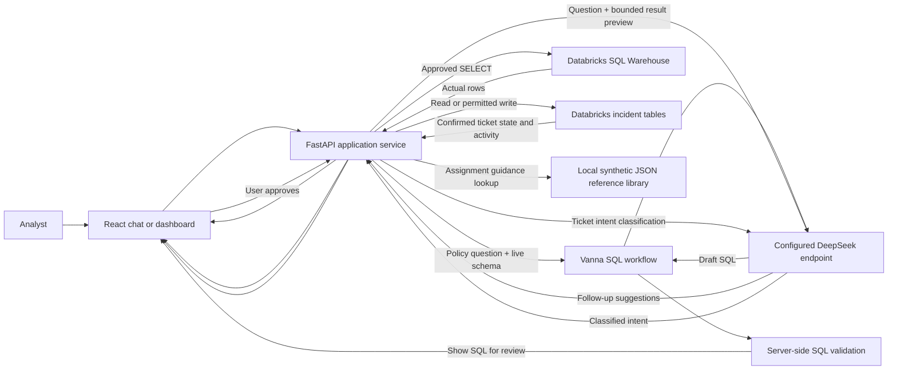
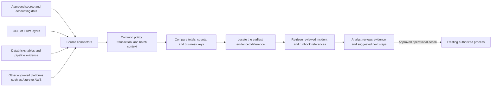

# Progressive AI — Policy Intelligence & Incident Management POC

## Executive overview

Progressive AI is a proof of concept for helping insurance and data operations teams ask questions about policy information and manage data-related incidents through one familiar experience. Users can ask policy questions in plain language, inspect and approve a generated query, view the actual returned records, and work with incident tickets from chat or a dashboard.

The longer-term vision is an AI-assisted investigation capability that compares policy and premium information across approved data platforms and processing layers, helps analysts find where a discrepancy first appears, and recommends evidence-based next steps. That broader cross-platform reconciliation capability is a roadmap goal; it is not implemented in the current POC.

> **Status at a glance:** The current POC has a working Databricks-backed policy query flow and incident ticket workflow. It is not yet a multi-platform reconciliation engine, autonomous fixer, or production enterprise service.

## The business problem

Policy and premium issues can cross several systems and processing steps. Today, an analyst may need to compare source records, transformed data, warehouse tables, and reports by hand to answer questions such as:

- Why does a premium total differ between two reports?
- Which policy or transaction is missing from a downstream layer?
- Is a coverage record absent, duplicated, or associated with the wrong policy?
- Which incident tickets are waiting for an owner or additional information?
- What should the assigned analyst check first?

The work can involve repeated SQL, manual navigation between systems, and ticket coordination. The POC explores whether a guided natural-language interface and a shared incident workflow can reduce that effort while keeping people in control of query execution and ticket actions.

## What the POC provides today

### Policy questions in chat

An analyst can ask a question in everyday language about the configured policy data. The application retrieves current schema details for five approved Gold tables in Databricks, asks the configured DeepSeek endpoint to draft Databricks SQL through Vanna, and validates the draft on the server.

The chat shows the SQL for review. The query runs only after the user approves it. Successful results are the rows returned by the Databricks SQL Warehouse, with a row count and elapsed time. Where available, the assistant also suggests follow-up questions based on the question and result.

Examples to demonstrate the flow:

- “Compare written premium by state.”
- “Show coverage codes and written premium by policy.”
- “Show the transaction types and written premium for policy WC-1003.”

The current query allowlist is limited to these tables in `workspace.default`:

- `gold_policy_reporting_summary`
- `gold_dim_policy_jacket`
- `gold_fact_policy_transaction`
- `gold_fact_coverage`
- `gold_fact_charge`

Only a single read-only `SELECT` against approved Gold tables is accepted. The result is capped at 200 rows. The application does not treat generated SQL as trusted merely because an LLM produced it.

### Incident work in chat and the dashboard

Incident Management reads ticket, team, linked-policy, and activity records from the configured Databricks incident tables. Users can view tickets in the dashboard or ask supported questions in chat, including requests to list unassigned tickets or tickets assigned to them.

Supported ticket actions include claiming or assigning an unassigned ticket, reassigning when permitted, unassigning, changing status, and declining a request. Ticket status changes and assignment activity are written through the backend to Databricks. The dashboard and chat reflect confirmed changes, and the dashboard includes status counts, status filtering, recent activity, and refresh behavior.

Normal users can act on tickets assigned to them and claim unassigned work under the POC rules. Admin has broader ticket-management permissions. The account picker is a demonstration identity selector—not verified corporate authentication—so these roles must not be treated as a production security boundary.

After assignment, the application can show a short investigation guide based on a locally stored reference library. The library contains **synthetic illustrative examples**, not verified historical Progressive incidents or proven fixes. Its suggestions are starting points to validate against current data and approved procedures.

### Policy Dashboard

The Policy Dashboard presents a visual policy-quality experience. Its current summary metrics and trend examples are illustrative UI content; they are not live policy-quality measurements from Databricks. Use the chat query workflow when demonstrating actual policy records and query results.

## How a request flows through the current POC

The application separates model assistance from data access. The model drafts SQL or classifies a supported incident request; the server validates the request and uses its own configured connection to Databricks.

### In plain language

1. **The user asks.** The React interface sends the request to the application backend.
2. **The assistant prepares.** For policy questions, the backend retrieves current metadata from the approved tables and asks the configured LLM to draft SQL. For ticket requests, the LLM classifies the request into a supported intent.
3. **The server applies guardrails.** Policy SQL must pass read-only parsing and table allowlist checks. Ticket actions go through role and ownership checks.
4. **A person approves policy SQL.** The query is displayed before execution; no policy query runs until the user approves it.
5. **Databricks supplies the data.** The backend submits approved work and returns actual database results or a clear error.
6. **The interface presents the outcome.** Policy results appear in a table. Ticket changes appear in chat and the incident dashboard after Databricks confirms them.

## Current data and AI connections

| Area | Current POC connection | What it is used for |
| --- | --- | --- |
| Policy data | Databricks SQL Warehouse and five approved Gold tables | Schema discovery and read-only policy queries |
| Incident management | Databricks incident tables | Ticket, roster, linked-policy, and activity reads; supported ticket updates |
| SQL assistant | Vanna workflow with a configured DeepSeek-compatible endpoint | Drafting SQL from a question and schema context |
| Ticket chat | Configured DeepSeek endpoint plus deterministic server-side ticket services | Classifying supported ticket requests; server performs the actual read or action |
| Investigation references | Local JSON library | Retrieving a synthetic example and its suggested checks after assignment |
| User interface | React web application | Chat, query review, results, policy and incident dashboards, and the project guide |

The LLM does not receive Databricks credentials and does not directly execute queries. The backend owns the database connection. To generate SQL, the configured endpoint receives the user's question and relevant schema/business context. Follow-up generation can also receive a bounded preview of returned columns and rows so suggestions can refer to the result. Data-governance approval for the configured model endpoint and any data sent to it is a prerequisite for use with sensitive information.

## Controls and responsible use

- **Human review for policy queries:** Users inspect and approve generated SQL before execution.
- **Read-only policy access:** The current query path permits one validated `SELECT` against approved Gold tables and limits returned rows.
- **Server-side credentials:** Database and model credentials belong in server-side configuration, never in browser code.
- **Permission-checked ticket actions:** The backend checks the selected POC identity, role, ticket owner, and supported status/action before writing.
- **Confirmed results only:** The interface should show database results or confirmed ticket updates, not invented outcomes.
- **Guidance is not a diagnosis:** Synthetic investigation examples are illustrative; users must verify suggestions against current evidence and approved runbooks.
- **POC identity caveat:** Selecting a name in the account menu does not establish that the person is who they claim to be. Production use requires approved identity, authorization, audit, and data-retention controls.
- **Deployment access gate:** A deployment may also use a shared POC access code. That limits entry but is not a substitute for individual authentication or enterprise SSO.

## Business value this POC is intended to test

The POC is intended to test whether a single, guided experience can:

- Reduce the time analysts spend translating routine questions into SQL.
- Make policy information easier to explore for people who do not write SQL every day.
- Keep query execution understandable by showing the SQL and requiring approval.
- Give teams a shared view of ticket ownership, status, linked policies, and recent activity.
- Help an assigned analyst get a useful first set of investigation checks instead of starting from a blank page.
- Create a foundation for evidence-led premium and data-quality investigations across processing layers.

These are goals to measure, not benefits already proven by the POC. A pilot evaluation could compare time to answer representative questions, time to locate a discrepancy, ticket handoff time, and the percentage of suggestions analysts find useful. Any results should be measured with agreed baselines and real, approved scenarios.

## Current boundaries

The current version does **not**:

- Query SQL Server, Azure SQL, Snowflake, accounting systems, ODS, or AWS-hosted data.
- Reconcile the same policy across multiple platforms or identify the earliest point of divergence.
- Automatically prove a root cause or guarantee that a suggested resolution will work.
- Automatically modify policy or premium data, rerun pipelines, or repair production records.
- Create new incident tickets; ticket creation is a placeholder in the current dashboard.
- Use a production vector database for historical incident retrieval.
- Provide enterprise SSO or production-grade per-user identity verification.
- Treat the Policy Dashboard's illustrative metrics as live operational measurements.

## Future direction: cross-platform premium investigation

The next major capability is a human-supervised investigation workflow for out-of-balance premiums and missing or inconsistent policy records. The target is to compare approved data across the relevant parts of the business flow—for example, source/accounting data, ODS or EDW layers, Databricks, and approved AWS- or Azure-hosted sources where applicable.

This is an extensible direction, not a claim that these connectors or automated comparisons are already available. The future system should show the evidence behind a finding, distinguish confirmed facts from hypotheses, quantify the affected records or premium where the data supports it, and recommend a next step. Any correction or operational change should stay with an authorized human and the established system of record.

### Potential roadmap

1. **Validate definitions:** Agree on premium measures, policy/transaction keys, time windows, and what counts as an imbalance with business owners.
2. **Connect approved sources:** Add connector modules for selected platforms such as Azure SQL, SQL Server, Snowflake, or AWS-hosted data after access, governance, and ownership are approved.
3. **Map the data flow:** Document how policy records move through source, ODS/EDW, Databricks, and reporting layers, including lineage and batch identifiers.
4. **Build reconciliation evidence:** Compare totals, row counts, and business keys across selected layers; identify the first observed divergence without assuming its cause.
5. **Strengthen knowledge retrieval:** Replace synthetic examples with reviewed historical incidents and approved runbooks; evaluate local search versus a vector database based on volume and access needs.
6. **Add evidence-based investigation:** Present similar cases, diagnostic checks, data evidence, uncertainty, and references in a concise analyst workflow.
7. **Prepare for production:** Add enterprise identity, least-privilege authorization, audit requirements, monitoring, retention rules, and deployment review.

## Suggested stakeholder walkthrough

1. Open **How this works** for the short architecture walkthrough and current POC boundaries.
2. In **New chat**, ask: “Compare written premium by state.” Inspect the generated SQL, approve it, and review the returned rows and suggested next questions.
3. Ask: “List all unassigned incident tickets.” Open a ticket, review its linked policy information, and assign it using the available action.
4. Open **Incident Management** to see the confirmed owner/status, dashboard counts, and recent activity. Review the illustrative investigation guide as a starting point—not as a verified historical resolution.
5. Explain the next phase as a proposal: approved connectors and verified business definitions would be needed before cross-platform reconciliation can be demonstrated.

## Related project material

- **How this works:** The in-app walkthrough describing current flows, examples, controls, and future extension points.
- **Incident roadmap:** [`docs/incident-management-roadmap.md`](docs/incident-management-roadmap.md) for incident workflow behavior, identity caveats, and planned incident capabilities.
- **Workers' Compensation knowledge base:** [`knowledge_base/Progressive_Agentic_POC_Workers_Compensation_Knowledge_Base.md`](knowledge_base/Progressive_Agentic_POC_Workers_Compensation_Knowledge_Base.md) for the POC's domain context and documented data concepts.
- **Illustrative incident examples:** [`knowledge_base/illustrative_resolved_incident_cases.md`](knowledge_base/illustrative_resolved_incident_cases.md) for the synthetic reference cases used by assignment guidance.

---

*This README is a stakeholder-oriented description of the current proof of concept and its intended direction. Update the “today” sections whenever application behavior or connected data sources change; label new capabilities as planned until they are implemented and validated.*
